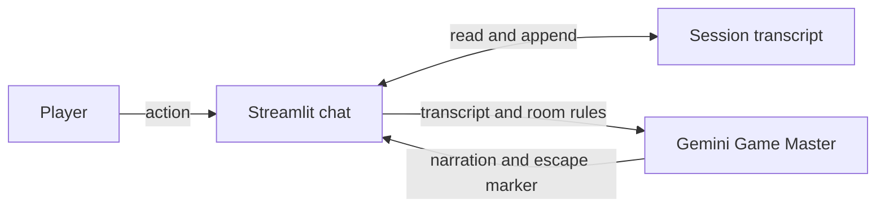
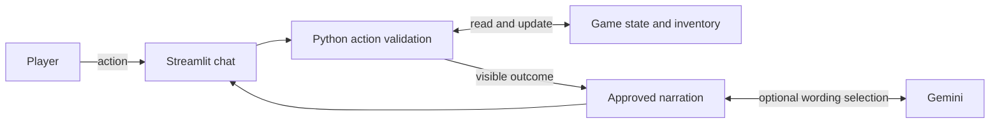
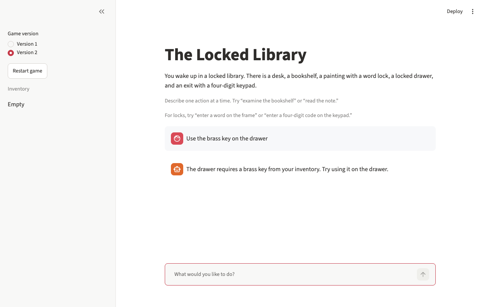
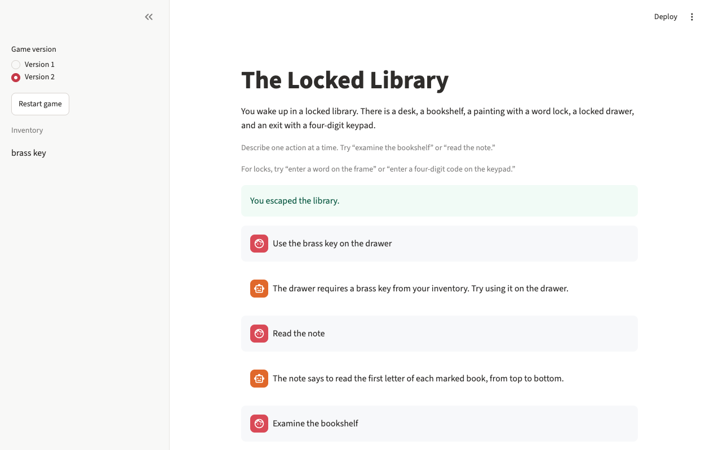

# AI Escape Room

The Locked Library is a chat-based escape room built with Python, Streamlit, and the Gemini API. Find the marked books, follow the clues, and open the exit. The sidebar lets you play both versions and restart either game.

## Run locally

From the project folder in the VS Code terminal on macOS or Linux:

```bash
python3 -m venv .venv
source .venv/bin/activate
python -m pip install -r requirements.txt
cp -n .env.example .env
python -m streamlit run app.py
```

For Version 1, create a Gemini API key in [Google AI Studio](https://aistudio.google.com/apikey) using a free-tier project. Set `GEMINI_API_KEY` in your local `.env` and restart Streamlit. The template supplies a model name through `GEMINI_MODEL`. Version 2 can be played without a key. When a key is present, Gemini selects an approved narration for each action.

Try “examine the desk” or “examine the bookshelf.” Version 2 accepts one action at a time, with phrases such as “read the note,” “enter WORD on the frame,” or “use the brass key on the drawer.”

## Version 1 · Gemini runs the game

The first Streamlit starter sent only the latest action to Gemini. Version 1 adds the room design, keeps the chat transcript across turns, and recognizes the model's escape marker. Gemini interprets actions, tracks progress from the transcript, and narrates the result. If Gemini produces the marker by mistake, the UI ends the game early.



## Version 2 · Python checks each move

Python keeps the inventory, lock status, clue discoveries, and escape status in session state. It accepts a small set of action phrases and applies the room rules before asking Gemini to narrate. Gemini sees only the visible outcome and can choose one of two approved phrasings. Unexpected model text and API errors fall back to the Python outcome.



## Tests and demonstration

```bash
python -m unittest discover -s tests -v
```

See the [test cases and results](docs/playtests.md), [two-page project report](docs/project-report.pdf), and [room design with solutions](docs/room-design.md).

| Missing-key attempt | Successful escape |
| --- | --- |
|  |  |
